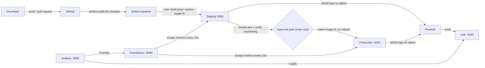

# System Health Dashboard API

A small Flask API that reports its own health, and the delivery and monitoring system around it.

- **Mini Project 1** built the API, tests, Docker image and a Jenkins pipeline.
- **Mini Project 2 (this release, v2.0.0)** adds Prometheus metrics, structured logs, staging and production environments, Continuous Delivery from Jenkins, a Prometheus + Grafana + Loki monitoring stack, alert rules and an incident drill.

## Contents

1. [Overview](#overview)
2. [Architecture](#architecture)
3. [Prerequisites](#prerequisites)
4. [Setup and configuration](#setup-and-configuration)
5. [Running locally and tests](#running-locally-and-tests)
6. [Metrics and logging](#metrics-and-logging)
7. [Docker image](#docker-image)
8. [Staging and production environments](#staging-and-production-environments)
9. [Monitoring stack](#monitoring-stack)
10. [Jenkins pipeline](#jenkins-pipeline)
11. [Incident drill](#incident-drill)
12. [Evidence](#evidence)
13. [Git workflow](#git-workflow)
14. [Reflections](#reflections)
15. [AI assistance](#ai-assistance)

## Overview

The API returns basic status information for engineers and automated monitoring checks.

| Endpoint | Returns | Example response |
|----------|---------|------------------|
| `/health` | Whether the service is up, the current time and uptime | `{"status": "healthy", "timestamp": "2026-10-26T22:47:29+00:00", "uptime_seconds": 1.5}` |
| `/version` | The service name and application version | `{"service": "system-health-dashboard", "version": "2.0.0"}` |
| `/environment` | The environment the app is running in, and the host that answered | `{"environment": "staging", "hostname": "5e48fbc4ba95"}` |
| `/metrics` | Metrics in the Prometheus text format | `http_requests_total{endpoint="/health",method="GET",status="200"} 12.0` |
| `/simulate-error` | HTTP 500 and an ERROR log line, **only** when `ENABLE_FAULT_INJECTION=true`; otherwise HTTP 404 | `{"error": "Simulated internal error"}` |

Unknown routes return a JSON error with HTTP 404: `{"error": "Endpoint not found"}`.

`/simulate-error` exists only for the incident drill. Production has fault injection fixed to `false` in its Compose file.

## Architecture



**Delivery flow.** A commit reaches Jenkins, which runs the tests and builds one image tagged with the build number. On `develop` and `main` that image is deployed to staging automatically and smoke tested. On `main` only, the pipeline then pauses for a person to approve; the same image is deployed to production and smoke tested again. If any step fails, the environments the build touched are rolled back to their last known good tag.

**Observability flow.** Both environments expose `/metrics` and write one JSON log line per request to stdout. Prometheus scrapes both by container name on the shared `sre-monitoring` Docker network. Promtail reads the container logs through the Docker API and labels them with `environment` and `app`, and Loki stores them. Grafana reads from both and shows them on one dashboard.

## Prerequisites

| Tool | Version used | Purpose |
|------|--------------|---------|
| Git | 2.x | Version control |
| Python | 3.11 or later | Running the app and tests locally |
| Docker Desktop (with Compose v2) | Current | Building images, running both environments and the monitoring stack |
| Jenkins | LTS (run locally in Docker) | CI/CD pipeline. It needs the Docker CLI **and the Docker Compose plugin**, and the host's Docker socket mounted |
| curl | Any | Verifying endpoints and running the smoke test |
| Bash | Any (Git Bash on Windows) | Running `scripts/smoke_test.sh` and `scripts/rollback.sh` |

## Setup and configuration

```bash
git clone https://github.com/letta-Lana/system-health-dashboard.git
cd system-health-dashboard

python -m venv venv
source venv/Scripts/activate     # Windows (Git Bash)
# source venv/bin/activate       # macOS / Linux

pip install -r requirements.txt
```

`(venv)` appears in your prompt when the virtual environment is active. Activate it again in every new terminal.

Configuration is read from environment variables, so nothing is hard-coded in the source.

| Variable | Purpose | Default |
|----------|---------|---------|
| `ENVIRONMENT` | Environment name returned by `/environment`, used in logs and in `app_info` | falls back to `APP_ENV` |
| `APP_ENV` | Older name for `ENVIRONMENT`, still honoured so Mini Project 1 setups keep working | `development` |
| `APP_VERSION` | Version returned by `/version` and shown in `app_info` | `2.0.0` |
| `ENABLE_FAULT_INJECTION` | `true` switches `/simulate-error` on; anything else leaves it returning 404 | `false` |

Set them when starting the app:

```bash
ENVIRONMENT=staging APP_VERSION=2.0.0 python app.py
```

The monitoring stack has its own settings in `monitoring/.env` (see [Monitoring stack](#monitoring-stack)). That file is not committed.

## Running locally and tests

```bash
python app.py
```

The app listens on port 5000. In a second terminal:

```bash
curl http://localhost:5000/health
curl http://localhost:5000/version
curl http://localhost:5000/environment
curl http://localhost:5000/metrics
```

Stop the server with Ctrl+C. The app starts with `werkzeug.serving.run_simple` instead of `app.run`, because `app.run` prints a plain-text banner and stdout must contain only JSON log lines.

Run the full suite from the project root with the virtual environment active:

```bash
python -m pytest -v
```

Passing output ends with `16 passed`. The tests use Flask's test client, so the server does not need to be running.

| Test | Checks |
|------|--------|
| `test_health_returns_healthy` | `/health` returns 200 and `"status": "healthy"` |
| `test_version_returns_a_version` | `/version` returns 200 and a `version` key |
| `test_environment_defaults_to_development` | `/environment` returns `development` when neither variable is set |
| `test_environment_reads_app_env` | `/environment` returns the value of `APP_ENV` |
| `test_environment_variable_takes_priority_over_app_env` | `ENVIRONMENT` wins over `APP_ENV` |
| `test_unknown_route_returns_404` | An unknown route returns 404 |
| `test_metrics_endpoint_returns_prometheus_text` | `/metrics` returns 200 in the Prometheus text format with the request metrics |
| `test_metrics_include_app_info_and_uptime` | `app_info` and `app_uptime_seconds` are exposed |
| `test_each_request_writes_one_valid_json_log_line` | One valid JSON log line per request with all required fields |
| `test_unknown_route_is_logged_as_warning` | A 404 is logged at WARNING with the requested path |
| `test_simulate_error_is_404_when_fault_injection_is_off` | The switch is closed when unset or `false` |
| `test_simulate_error_returns_500_when_fault_injection_is_on` | The switch opens with `true` |
| `test_simulate_error_is_logged_at_error_level_and_counted` | The fault is logged at ERROR and counted with status 500 |
| `test_request_counter_increments` | `http_requests_total` rises after a request |
| `test_unknown_routes_share_one_endpoint_label` | Random URLs share the label `unknown` instead of creating new series |
| `test_latency_histogram_records_observations` | The latency histogram records each request |

pytest's built-in `monkeypatch` fixture sets or clears environment variables for a single test only.

## Metrics and logging

### Metrics

Exposed at `/metrics` using the `prometheus_client` library.

| Metric | Type | Labels | Purpose |
|--------|------|--------|---------|
| `http_requests_total` | Counter | `method`, `endpoint`, `status` | Every request, including 404 and 500 responses |
| `http_request_duration_seconds` | Histogram | `endpoint` | Request latency, used for the p95 panel |
| `app_info` | Gauge (always 1) | `version`, `environment` | Which version and environment is running |
| `app_uptime_seconds` | Gauge (custom) | none | Seconds since the app started |

The `endpoint` label is the route pattern, such as `/health`, and `unknown` for any path that matches no route. Using the raw path would let random URLs create an endless number of time series.

**Custom metric.** `app_uptime_seconds` resets to 0 on every restart, so a sudden drop on a graph shows a crash or a redeploy.

When Prometheus scrapes `app_info`, the app's own `environment` label clashes with the `environment` label Prometheus attaches to the target. Prometheus keeps its own and renames the app's to `exported_environment`. This is expected, and the dashboard's Application info table shows both.

### Structured logs

Every request writes exactly one JSON object per line on stdout:

```json
{"timestamp": "2026-11-09T10:32:27.130574+00:00", "level": "ERROR", "message": "Simulated fault injected", "endpoint": "/simulate-error", "path": "/simulate-error", "method": "GET", "status": 500, "environment": "staging"}
```

| Field | Meaning |
|-------|---------|
| `timestamp` | UTC time of the response |
| `level` | `ERROR` for 5xx, `WARNING` for 4xx, `INFO` otherwise |
| `message` | What happened (`request completed`, or `Simulated fault injected`) |
| `endpoint` | Route pattern, or `unknown` |
| `path` | The path that was actually requested |
| `method`, `status` | HTTP method and response status |
| `environment` | Value of `ENVIRONMENT` |

Check that every line is valid JSON (`jq` fails loudly on any other line):

```bash
docker logs app-staging 2>&1 | jq .
```

## Docker image

The Dockerfile is based on the official `python:3.11-slim` image and installs dependencies before copying the code, so Docker can reuse the cached dependency layer when only the code changes. `PYTHONUNBUFFERED=1` makes log lines reach Docker immediately. The app listens on all network interfaces (`0.0.0.0`) with debug mode off. Without this, the app only accepts connections from inside the container, so requests from the host fail even with the port mapped. The `.dockerignore` keeps the virtual environment, Git history, cache files and local env files out of the image.

Build a versioned image:

```bash
docker build -t system-health:local .
docker images system-health
```

Run one container and check it:

```bash
docker run -d -p 5000:5000 -e ENVIRONMENT=staging --name health-api system-health:local
curl http://localhost:5000/health
docker logs health-api
docker stop health-api && docker rm health-api
```

## Staging and production environments

Two Compose files run the same image side by side as separate Compose projects. They join the shared Docker network `sre-monitoring`, so Prometheus can reach them by container name.

| | Staging | Production |
|---|---------|------------|
| Compose file | `docker-compose.staging.yml` | `docker-compose.production.yml` |
| Container name | `app-staging` | `app-production` |
| Host port | 5001 | 5002 |
| `ENVIRONMENT` | `staging` | `production` |
| Fault injection | `ENABLE_FAULT_INJECTION`, default `false` | Fixed to `false` |

Create the network once, then deploy any image tag. Always pass `-p` so the two projects stay separate:

```bash
docker network create sre-monitoring

IMAGE_TAG=local docker compose -p staging    -f docker-compose.staging.yml    up -d
IMAGE_TAG=local docker compose -p production -f docker-compose.production.yml up -d

curl http://localhost:5001/environment      # staging
curl http://localhost:5002/environment      # production
curl -i http://localhost:5001/simulate-error  # 404 while fault injection is off
```

## Monitoring stack

All four services run in containers from `monitoring/docker-compose.monitoring.yml`. Data sources and the dashboard are provisioned from files, so no manual clicking in a web UI is needed.

| Service | Port | Role |
|---------|------|------|
| Prometheus | 9090 | Scrapes both environments, evaluates alert rules |
| Grafana | 3000 | Dashboards |
| Loki | 3100 | Stores logs |
| Promtail | none | Collects Docker container logs and labels them |

### Start it

```bash
docker network create sre-monitoring          # skip if it already exists
cd monitoring
cp .env.example .env                          # then edit .env and choose your own password
docker compose -f docker-compose.monitoring.yml up -d
```

`monitoring/.env` is ignored by Git and never committed. Grafana will not start without `GRAFANA_ADMIN_PASSWORD`, and Compose says so.

The stack has memory limits (about 1.8 GB in total) so it fits on a small laptop.

### Log in to Grafana

Open <http://localhost:3000>. Log in with `GRAFANA_ADMIN_USER` and `GRAFANA_ADMIN_PASSWORD` from your `monitoring/.env` (`.env.example` shows the variable names; its default user is `admin`). The dashboard **System Health Overview** is in the **SRE** folder: <http://localhost:3000/d/system-health-overview>.

### Verify monitoring

1. **Targets.** <http://localhost:9090/targets> shows `app-staging:5000` and `app-production:5000` both **UP**.
2. **Alert rules.** <http://localhost:9090/alerts> lists `ServiceDown` and `HighErrorRate`.
3. **Metrics respond to traffic.** Generate traffic, then watch the Request rate panel move:

   ```bash
   for i in $(seq 1 50); do curl -s localhost:5001/health > /dev/null; curl -s localhost:5002/health > /dev/null; done
   ```

4. **Logs.** In Grafana, open Explore, choose the Loki data source and run `{environment="staging"}`. The same query with `| json | level="ERROR"` shows only errors.
5. **Start from scratch.** Prove that everything comes from the repository files:

   ```bash
   cd monitoring
   docker compose -f docker-compose.monitoring.yml down -v     # -v also wipes Grafana's database
   docker compose -f docker-compose.monitoring.yml up -d
   ```

   Targets are UP, both data sources exist and the dashboard is there without clicking anything.

### Dashboard: System Health Overview

One provisioned dashboard with an **Environment** dropdown (staging, production or All).

| Panel | Shows | Source |
|-------|-------|--------|
| Service status | UP or DOWN per environment | Prometheus `up` |
| Application info | Running version and environment | Prometheus `app_info` |
| Request rate | Requests per second by endpoint | `rate(http_requests_total[1m])` |
| Error rate % | Share of 5xx responses over 2 minutes, red above 5% | `http_requests_total` with `status=~"5.."` |
| Latency p95 | 95th percentile latency per endpoint | `histogram_quantile` on the duration histogram |
| Application logs | Recent log lines for the selected environment | Loki |
| Error logs | Only ERROR level lines | Loki, `\| json \| level="ERROR"` |

### Alert rules

Defined in `monitoring/prometheus/alerts.yml`.

| Alert | Fires when | Severity |
|-------|------------|----------|
| `ServiceDown` | An application target has been down for 1 minute | critical |
| `HighErrorRate` | More than 5% of requests returned 5xx over 2 minutes, for 1 minute | warning |

The `for: 1m` on `HighErrorRate` stops one short spike from firing the alert. After editing a rule, validate and reload it:

```bash
docker run --rm --entrypoint promtool -v "$PWD/monitoring/prometheus:/p" prom/prometheus:v3.15.1 check rules /p/alerts.yml
curl -X POST http://localhost:9090/-/reload
```

## Jenkins pipeline

The `Jenkinsfile` defines a declarative pipeline. The job uses **Pipeline script from SCM**, pointing at this repository. Jenkins polls for new commits every couple of minutes, so a merged change reaches staging without anyone typing a command.

| Stage | Runs on | What it does |
|-------|---------|--------------|
| Checkout | all branches | `checkout scm` retrieves the repository and branch configured in the job |
| Install | all branches | Creates a virtual environment and installs `requirements.txt` |
| Test | all branches | Runs `python -m pytest -v`. A failing test stops the pipeline |
| Build and tag | all branches | `docker build -t system-health:${BUILD_NUMBER} .` Built exactly once |
| Health check | all branches | Runs the tagged image on port 5050 and curls `/health` up to 10 times |
| Deploy to Staging | `develop`, `main` | Starts that tag in the staging Compose project (port 5001) |
| Smoke test (staging) | `develop`, `main` | `scripts/smoke_test.sh` checks `/health`, `/version` and `/metrics`. Records `last_good_staging` |
| Verify monitoring | `develop`, `main` | Queries the Prometheus API and confirms the staging target is UP, retrying while the first scrape happens |
| Approval | `main` only | `input` step pauses the pipeline until a person approves. The approver's name is printed |
| Deploy to Production | `main` only | Starts **the same image tag** in the production Compose project (port 5002). No rebuild |
| Smoke test (production) | `main` only | Repeats the smoke test. Records `last_good_production` |
| Post: failure | all branches | Runs `scripts/rollback.sh` for each environment this build touched |
| Post: always | all branches | Removes the temporary test container |

**Tagging.** Each run produces an image such as `system-health:42`, so every running container can be traced to its Jenkins build.

**Failure handling.** A failing test stops the pipeline before an image is built. A failing smoke test fails the build and triggers the rollback.

**Local Jenkins setup.** Jenkins runs as a Docker container with Python, the Docker CLI and the Docker Compose plugin added, and with the host's Docker socket mounted. Because Jenkins is itself a container, it reaches the apps and Prometheus through `host.docker.internal` rather than `localhost`. Confirm this before the first run: add a scratch step with `docker version && docker compose version`.

**No secrets in the Jenkinsfile.** The pipeline needs none: images stay on the local Docker host and the Grafana password lives in the untracked `monitoring/.env`. If a registry or token is added later, store it in Jenkins credentials and read it with `withCredentials`.

### Continuous Delivery or Continuous Deployment?

This pipeline is Continuous Delivery. Every change merged to `develop` or `main` is tested, built once and deployed to staging automatically, and must pass a smoke test there. Production only receives that same image after a person approves it at the Jenkins `input` step on `main`. Removing the Approval stage, so that a passing staging smoke test flows straight into the production deploy, would turn it into Continuous Deployment.

### Approve a release

1. Merge into `main`. Jenkins picks it up, or click **Build Now** on the `main` build.
2. Open the build's **Stage View**. After the staging checks, the pipeline pauses at **Approval**.
3. Click **Deploy** in the prompt (or the paused stage). The approver's user name is printed in the console.
4. Production deploys that same tag. Confirm: `curl localhost:5002/version` and `docker inspect -f '{{.Config.Image}}' app-production`.

If nobody answers within 30 minutes the build is aborted, which is not treated as a failure and does not roll anything back.

### Roll back

**Automatic.** If any stage fails after a deploy, the `post { failure }` block runs `scripts/rollback.sh` for each environment the build touched. The script reads `last_good_<environment>` from `$JENKINS_HOME/system-health-state`. That file is written only after the environment's smoke test passed, so it always holds the previous working tag. The console shows `Rolling back staging to system-health:N`.

**Manual.** Redeploy any known tag directly:

```bash
IMAGE_TAG=<previous build number> docker compose -p production -f docker-compose.production.yml up -d
docker inspect -f '{{.Config.Image}}' app-production      # shows the running tag
```

Or use the script, pointing it at the state folder and the host Jenkins reaches:

```bash
STATE_DIR=/path/to/system-health-state DEPLOY_HOST=localhost ./scripts/rollback.sh production
```

## Incident drill

The drill proves the system can detect, diagnose and recover from a fault using only the dashboards. Record the timeline in [`INCIDENT.md`](INCIDENT.md).

1. Start steady traffic and leave it running:

   ```bash
   while true; do curl -s localhost:5001/health > /dev/null; curl -s localhost:5001/version > /dev/null; sleep 0.5; done
   ```

2. Turn fault injection on for **staging only**, using the tag that is currently deployed:

   ```bash
   ENABLE_FAULT_INJECTION=true IMAGE_TAG=<current tag> docker compose -p staging -f docker-compose.staging.yml up -d
   ```

3. In a second terminal, call the fault endpoint repeatedly until the Error rate panel rises and `HighErrorRate` fires (pending first, then firing after its minute):

   ```bash
   while true; do curl -s localhost:5001/simulate-error > /dev/null; sleep 0.3; done
   ```

4. Find the ERROR lines in the Error logs panel, or in Explore with `{environment="staging"} | json | level="ERROR"`. The `endpoint` and the first `timestamp` give the cause and the start time.
5. Recover by redeploying staging without the variable (it defaults to `false`), or roll back to the previous release.
6. Confirm the error rate returns to normal. The 2-minute window needs a few minutes to clear before the alert resolves.

## Evidence

Screenshots live in [`screenshots/`](screenshots/); the checklist of the eight required files is in [`screenshots/README.md`](screenshots/README.md). The incident timeline is in [`INCIDENT.md`](INCIDENT.md).

## Git workflow

The project follows a simplified GitFlow model:

- `main`: reviewed, release-ready code. It only changes through a pull request from `develop`.
- `develop`: integration branch. Feature branches are merged here first.
- `feature/<short-description>`: one branch per piece of work, created from `develop`.

Branches used:

| Branch | Work |
|--------|------|
| `feature/health-version-endpoint` | `/health` and `/version` endpoints (Mini Project 1) |
| `feature/environment-version-endpoint` | `/environment` endpoint reading `APP_ENV` (Mini Project 1) |
| `feature/tests` | pytest suite and `requirements.txt` (Mini Project 1) |
| `feature/docker` | Dockerfile and `.dockerignore` (Mini Project 1) |
| `feature/jenkins` | Jenkinsfile (Mini Project 1) |
| `feature/metrics` | `/metrics`, the three required metrics plus uptime, JSON logs, `/simulate-error`, new tests |
| `feature/cd-pipeline` | Staging and production Compose files, smoke test and rollback scripts, the extended Jenkinsfile |
| `feature/monitoring-stack` | Prometheus, Loki, Promtail and Grafana configuration, alert rules and the provisioned dashboard |
| `feature/docs` | README, `INCIDENT.md` and `REFLECTION.md` templates, screenshots checklist |

Commits are small with action-oriented messages, for example "Add request latency histogram". Pull request for Mini Project 1: <https://github.com/letta-Lana/system-health-dashboard/pull/11> (`develop` to `main`), reviewed by kpashindla29 before merging. The Mini Project 2 release goes through the same `develop` to `main` pull request with a review, and is tagged `v2.0.0`.

View the branch history with:

```bash
git log --oneline --graph --all
```

### Merge conflict record (Mini Project 1)

| Field | Details |
|-------|---------|
| Branches | `feature/health-version-endpoint` and `feature/environment-version-endpoint`, both merged into `develop` |
| File | `app.py` (whole file). Both branches created `app.py` independently, so Git raised an add/add conflict |
| Health branch changes | Added the `/health` and `/version` endpoints |
| Environment branch changes | Added the `/environment` endpoint, which reads `APP_ENV` and defaults to `development` |
| Resolution | Used the health/version file as the base, added `import os` and the `/environment` route above the `if __name__ == "__main__":` block. The final file has all three endpoints and a single `app.run` |
| Commands (resolve) | `git merge`, `nano app.py`, `git add app.py`, `git commit` |
| Commands (verify) | `cat app.py`, `python app.py`, curl against `/health`, `/version` and `/environment` |
| Issue found | The first resolution left a `<<<<<<< HEAD` marker in the file. The app failed to start with a SyntaxError, so I removed the marker and committed the fix |
| Commits | Merge: `6dcd466` · Fix: `5e2a01f` |
| Reference | mthree Git 2.2 Code-Along, Steps 4 to 6 |

**Lesson learned:** after resolving a conflict, check for leftover markers and run the app before committing. With the Jenkins Test stage in place, a broken file like this now fails the pipeline automatically.

## Reflections

The Mini Project 2 reflection (five questions) is in [`REFLECTION.md`](REFLECTION.md). The Mini Project 1 reflection follows.

**Which Git practice most improved the way I organised my work?** Feature branches. Keeping `/health` + `/version` and `/environment` on separate branches meant each change was small and easy to review, and merging them showed exactly where the two pieces of work overlapped. Planning the work as issues first also gave me a clear order to follow.

**Where did automation detect or prevent an error?** Two places. The pytest suite caught my intentional failure, and the Jenkins Test stage stopped the pipeline before an image was built. The health-check retry loop also prevented a false failure in build #1, where the app needed a moment to start before `/health` responded.

**What would I change before using this workflow in production?**

- Replace Flask's development server with a production WSGI server such as Gunicorn
- Split runtime and test dependencies so pytest isn't shipped in the production image
- Run the Jenkins container without `-u root`, and run the app container as a non-root user
- Push tagged images to a registry instead of keeping them only on the build machine
- Enforce branch protection on `main` so changes require an approved PR

**Which step still depends on manual action, and how could it be automated?** Starting Jenkins builds. I clicked Build Now after each push. A GitHub webhook or a multibranch pipeline could trigger builds automatically on every push and run the tests on pull requests before review. Deployment after a successful build is also manual and could become a pipeline stage. (Mini Project 2 adds that deployment stage and polling.)

## AI assistance

### Mini Project 1

| Area | What Claude did |
|------|-----------------|
| Planning | Organised the mthree course pages into a study map and blank templates for issues, the pipeline and the README |
| Learning support | Explained Git branches, virtual environments, environment variables and Flask concepts; reviewed my code and pointed out errors |
| `app.py` | Wrote the `/environment` route after I drafted it, and an upgraded version adding the timestamp, uptime, `APP_VERSION`, hostname and JSON 404 handler |
| Documentation | Tidied the wording of the Overview, Docker section and merge conflict record, and drafted this README |

I wrote the first `/health` and `/version` endpoints, set up the repository and branches, resolved the merge conflict, built and ran the Docker image, and built and ran the Jenkins pipeline myself.

### Mini Project 2

Claude (Claude Code, model Claude Sonnet 5.5) wrote the second half of this project from the Mini Project 2 participant guide. Its commits carry a `Co-Authored-By: Claude Sonnet 5.5` line, so the Git history shows exactly which work it did.

| Area | What Claude did |
|------|-----------------|
| Application | Added `/metrics` and the metrics, JSON request logging, `/simulate-error`, the `ENVIRONMENT` setting and the new tests |
| Environments and pipeline | Wrote both Compose files, `scripts/smoke_test.sh`, `scripts/rollback.sh` and the extended `Jenkinsfile` |
| Monitoring | Wrote the monitoring Compose file, Prometheus, Loki and Promtail configuration, the alert rules, the Grafana provisioning files and the dashboard JSON |
| Testing | Ran the test suite, started both environments and the monitoring stack in Docker, and checked the endpoints, smoke test, targets, rules, logs and dashboard against the running system |
| Documentation | Wrote this README, the architecture diagram and the `INCIDENT.md`, `REFLECTION.md` and screenshots templates |

Not done by Claude: the Jenkins pipeline runs, the approval, the rollback demonstration, the incident drill with its timeline, the screenshots and the reflection answers. These must be performed and written by the learner from their own running system.
